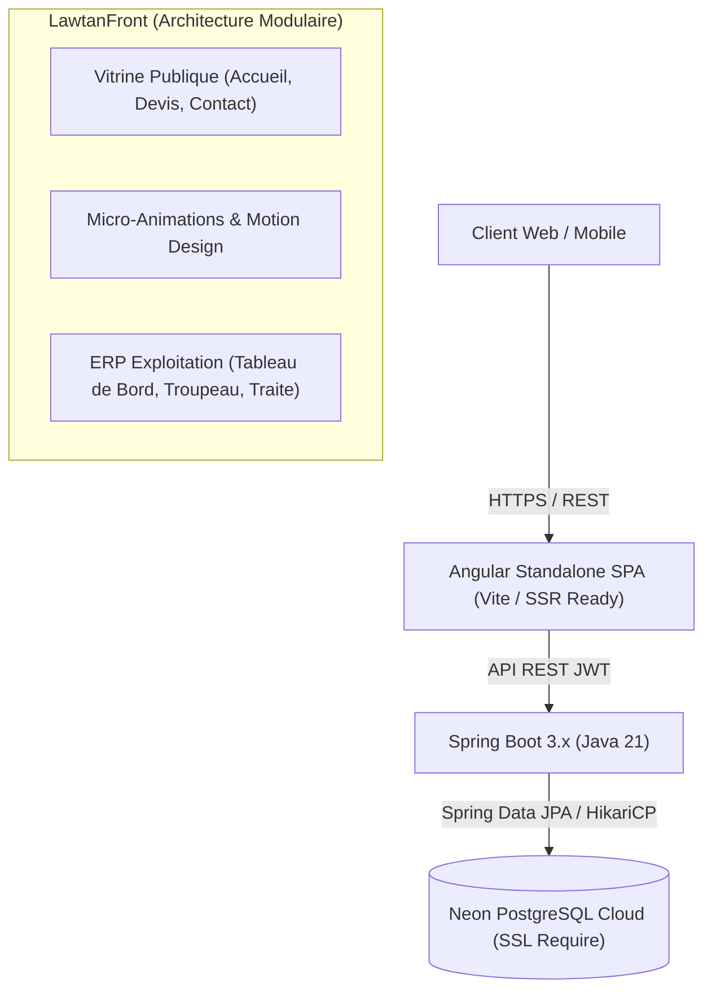

# LAWTAN BIO — Architecture, Motion Design & Master Prompt Senior

> **Plateforme Integree Agro-Industrielle & Elevage d'Elite 100% Solaire (Dagana, Senegal)**  
> *Portail Vitrine Client Awwwards-Grade & Systeme ERP de Gestion d'Exploitation Agropastorale.*

---

## Sommaire
1. [Vue d'Ensemble & Vision Projet](#1-vue-densemble--vision-projet)
2. [Stack Technique & Architecture Globale](#2-stack-technique--architecture-globale)
3. [Design System & Motion Design Awwwards-Grade](#3-design-system--motion-design-awwwards-grade)
   - [Tokens & Typographie de Maitre](#tokens--typographie-de-maitre)
   - [Composant Curseur Pastoral Interactif (`app-cow-cursor`)](#composant-curseur-pastoral-interactif-app-cow-cursor)
   - [Jauge de Defilement Pastorale (`app-scroll-progress`)](#jauge-de-defilement-pastorale-app-scroll-progress)
   - [Separateur Continu Anime du Troupeau (`app-pastoral-divider`)](#separateur-continu-anime-du-troupeau-app-pastoral-divider)
   - [Pagination Hero aux Bouteilles de Lait Bio Remplies en Temps Reel](#pagination-hero-aux-bouteilles-de-lait-bio-remplies-en-temps-reel)
   - [Panier / Reservation avec Niveau Dynamique dans le Bidon Traditionnel](#panier--reservation-avec-niveau-dynamique-dans-le-bidon-traditionnel)
4. [Ingenierie Responsive & Ergonomie Senior Mobile](#4-ingenierie-responsive--ergonomie-senior-mobile)
5. [Architecture Backend Spring Boot & Neon Cloud DB](#5-architecture-backend-spring-boot--neon-cloud-db)
6. [Le Prompt Senior de Reference (Creative Technologist & Lead Architect)](#6-le-prompt-senior-de-reference)
7. [Commandes Utiles & Guide de Deploiement](#7-commandes-utiles--guide-de-deploiement)

---

## 1. Vue d'Ensemble & Vision Projet

**LAWTAN BIO** est une exploitation agro-industrielle d'elite basee a Dagana, dans le bassin fertile du fleuve Senegal. Le projet repose sur trois piliers fondamentaux :
- **Autonomie Energetique & Zero Carbone** : Exploitation 100% alimentee par energie solaire.
- **Elevage d'Elite & Respect du Vivant** : Suivi individualise du cheptel (bovins laitiers haute genetique et beliers Ladoum), alimentation fourragere naturelle bio sans intrants chimiques.
- **Transformation Locale & Tracabilite Complete** : Production de lait frais scelle, lait caille traditionnel (*Sow*), beurre fermier baratte et fromages artisanaux.

Le logiciel est compose de deux environnements unifies :
1. **Portail Vitrine Public** (`LawtanFront/src/app/features/client`) : Experience immersive haut de gamme pour les clients et partenaires.
2. **Back-Office d'Exploitation (ERP)** (`LawtanFront/src/app/features/ferme`) : Gestion en temps reel du troupeau, des traites, des stocks d'aliments, des soins veterinaires, des commandes et de la facturation.

---

## 2. Stack Technique & Architecture Globale



- **Frontend** : Angular (Architecture Standalone, Signals reactifs, `@if` / `@for` nouvelle syntaxe de controle de flux, CSS natif sans dependance Tailwind restrictive, SVG inline animes).
- **Backend** : Spring Boot 3, Java 21, Spring Security avec filtres JWT sans etat, Spring Data JPA, Lombok.
- **Base de Donnees** : PostgreSQL Serverless heberge sur Neon Cloud avec SSL force.

---

## 3. Design System & Motion Design Awwwards-Grade

### Tokens & Typographie de Maitre
Les variables globales sont definies dans `styles.css` :
- **Palette Couleurs** :
  - `--agri-brand`: `#1E5E3A` (Vert Foret profond de la vallee)
  - `--agri-action`: `#2A7F48` (Vert prairie energique pour les CTA)
  - `--agri-pressed`: `#15442A` (Vert fonce sature au survol)
  - `--gold`: `#D9A441` (Or solaire sahelien pour accents et metriques)
  - `--ink`: `#0F172A` (Gris ardoise intense pour la lisibilite)
- **Typographie** :
  - Titres de Maitre : `'Fraunces'`, `'Outfit'`, serif noble avec variations typographiques.
  - Corps de texte : `'Manrope'`, `'Plus Jakarta Sans'`, sans-serif pour une clarte maximale.
- **Courbes d'Acceleration (Easing)** :
  - `--ease-out-expo`: `cubic-bezier(0.16, 1, 0.3, 1)`
  - `--ease-spring`: `cubic-bezier(0.34, 1.56, 0.64, 1)`

---

### Composant Curseur Pastoral Interactif (`app-cow-cursor`)
Fichier : `src/app/shared/components/cow-cursor/cow-cursor.component.ts`
- **Mecanique** :
  - Curseur personnalise desactive sur mobile/tactile via `(pointer: fine)` et `(hover: hover)`.
  - Vache stylisee miniature en SVG vectoriel avec animation physique de trot (`requestAnimationFrame`).
  - Detection cinematique de la vitesse : bascule automatique en trot (`is-walking`) avec balancement des pattes alterne.
  - Detection contextuelle de l'element survole :
    - `[data-state="action"]` sur les boutons : rotation des oreilles, dilatation et halo dore.
    - `[data-state="text"]` sur les champs de saisie : transformation en indicateur pastoral discret.
    - Clic utilisateur : contraction elastique et apparition d'une bulle pastorale *"Meuh !"* en typographie Fraunces.

---

### Jauge de Defilement Pastorale (`app-scroll-progress`)
Fichier : `src/app/shared/components/scroll-progress/scroll-progress.component.ts`
- **Mecanique** :
  - Barre ultra-fine (3px) fixee en haut d'ecran avec degrade or et vert bio.
  - Une vachette silhouette trotte a la tete de la barre en suivant exactement le pourcentage de scroll calcule via `window.scrollY / (scrollHeight - clientHeight)`.
  - Quand le defilement s'arrete, la vache passe en position d'arret paisible.

---

### Separateur Continu Anime du Troupeau (`app-pastoral-divider`)
Fichier : `src/app/shared/components/pastoral-divider/pastoral-divider.component.ts`
- **Mecanique** :
  - Frise decorative panoramique sans couture (*seamless loop*) separant les sections cles.
  - 3 animaux d'elite dessines en SVG haute precision :
    1. **Belier Ladoum d'Elite** : Cornes majestueuses torsadees or, port de tete noble et trot cadence.
    2. **Vache Laitiere d'Exception** : Robe mouchetee verte/creme, mamelle genereuse et cloche doree oscillante.
    3. **Chevreau Cabri** : Sautillement joueur et bondissant en arriere du cortege.
  - Decoration au sol : Touffes d'herbes du terroir senegalais et ligne de piste pastorale.
  - Deux troupes en relais continu (`sheep-caravan` et `sheep-caravan delay`) pour un defilement infini sans a-coup.

---

### Pagination Hero aux Bouteilles de Lait Bio Remplies en Temps Reel
Fichier : `src/app/features/client/accueil/accueil.component.html`
- **Mecanique** :
  - Au lieu de simples puces de carrousel circulaires sans ame, 3 veritables **bouteilles de lait en verre fermier** (SVG avec `clip-path`).
  - Pendant les 6,5 secondes d'affichage d'un slide, le niveau de lait blanc pur monte du bas vers le goulot avec un lisere cremeux.
  - Lors du passage au slide suivant, la bouteille active se vide instantanement tandis que la suivante commence son remplissage.
  - Clic interactif permettant de sauter directement a un slide avec transition Ken Burns sur l'image de fond.

---

### Panier / Reservation avec Niveau Dynamique dans le Bidon Traditionnel
Fichier : `src/app/features/client/accueil/accueil.component.ts`
- **Mecanique** :
  - Bouton flottant representant un **bidon a lait metallique traditionnel**.
  - `churnMilkLevelPercent` : Signal Angular calculant dynamiquement le remplissage du bidon en fonction du nombre de produits ajoutes.
  - Tiroir lateral de reservation fluide permettant de valider les commandes en direct via WhatsApp ou formulaire direct.

---

## 4. Ingenierie Responsive & Ergonomie Senior Mobile

1. **Navigation Sticky & Drawer Mobile Isole** :
   - Header fixe avec effet `backdrop-filter: blur(20px)`.
   - `.mobile-drawer` deporte avec `z-index: 999999` et verrouille par `display: none !important;` hors affichage mobile pour empecher toute interception fantome de clics.
   - Routage Angular sans `href="javascript:void(0)"` pour eviter les blocages de protocole et assurer une fluidite absolue sur iOS et Android.
2. **Carousel Mobile Touch-Native a Defilement Horizontal Snap** :
   - Sur mobile (< 768px), la grille de produits de la Gamme Laitiere se transforme en carrousel tactile naturel avec `scroll-snap-type: x mandatory` et `scroll-snap-align: start`.
   - Balayage au doigt instantane avec cartes compactes et pastilles de swipe.
3. **Selecteurs Cartes Dédies sur Mobile** :
   - Sur l'etape 1 du devis (`/devis`), le filtre d'onglets est remplace par deux cartes tactiles distinctes avec badges d'illustration, eliminant tout debordement horizontal.

---

## 5. Architecture Backend Spring Boot & Neon Cloud DB

- **Connexion Neon PostgreSQL** :
  - Configuration resiliente avec fallback d'environnement dans `application.properties` :
    ```properties
    spring.datasource.url=${SPRING_DATASOURCE_URL:jdbc:postgresql://ep-nameless-resonance-axyo4jaf-pooler.c-4.us-east-2.aws.neon.tech/neondb?sslmode=require}
    spring.datasource.username=${SPRING_DATASOURCE_USERNAME:neondb_owner}
    spring.datasource.password=${SPRING_DATASOURCE_PASSWORD:npg_fjMht3i1XJBl}
    ```
- **Securite JWT & Roles** :
  - Cle secrete robuste SHA-256 de 256 bits (`LAWTAN_JWT_SECRET`).
  - Validation sans etat (*Stateless*) pour securiser l'acces aux API du Back-Office Ferme.
- **Migration & Auto-Correction Schema** :
  - Classe `DataInitializer` executant les migrations SQL a chaud (adaptation des colonnes TEXT pour les images, suppression des contraintes CHECK restrictives pour les nouveaux produits laitiers, activation par defaut des clients).

---

## 6. Le Prompt Senior de Reference

*Copiez-collez ce prompt pour exiger un niveau de conception identique (Creative Technologist / Senior Software Architect) sur n'importe quel projet agropastoral ou industriel :*

```markdown
Tu es un Lead Creative Technologist & Senior Full-Stack Software Architect repute pour concevoir des applications web notees Awwwards « Site of the Day », alliant excellence visuelle, motion design haute precision et architecture logicielle robuste.

### OBJECTIF DU PROJET :
Creer une application web pour [NOM DE L'ENTREPRISE / MARQUE], leader dans [DOMAINE D'ACTIVITE]. L'application doit combiner :
1. Un portail public (Vitrine & Vente/Devis) captivant, elegant et riche en micro-interactions contextuelles.
2. Un module d'administration/gestion metier (ERP/Back-Office) professionnel, clair et ultra-ergonomique sur PC comme sur Mobile.

### STANDARDS D'INGENIERIE & ARCHITECTURE :
1. **Frontend** :
   - Angular Standalone avec Signals reactifs pour la gestion d'etat locale.
   - Rendu fluide 60fps sans saccade. Utiliser `requestAnimationFrame` et des transformations GPU (`transform: translate3d`, `will-change`).
   - CSS Vanille moderne / Tokens CSS personnalises (couleurs HSL/HEX profondes, typographies contrastees Display Serif + Body Sans-Serif).
   - Bannir les bibliotheques UI generiques ou Tailwind brut sans ame : chaque composant doit avoir sa propre identite visuelle.
   - Ne JAMAIS utiliser `href="javascript:void(0)"` dans les templates de navigation : utiliser `routerLink` natif ou des declencheurs de scroll programmes avec `scrollIntoView({ behavior: 'smooth' })`.
2. **Motion Design Awwwards-Grade** :
   - **Micro-interactions thematiques** : Concevoir des indicateurs vivants lies au metier (ex: curseur anime reagissant aux boutons et aux clics, barres de progression narratives, jauges SVG dynamiques qui se remplissent).
   - **Transitions continues** : Utiliser des separateurs decoratifs animes sans couture (*seamless loops*) en SVG pour rythmer les sections.
   - **Hero immersif** : Carrousel avec effet Ken Burns, titrage percutant et pagination animee mesurant le temps de chaque slide en temps reel.
3. **Mobile-First & Touch Engineering** :
   - Tout doit etre parfaitement manipulable au pouce : zones de clic minimum de 44x44px.
   - Remplacer les grilles statiques de produits sur mobile par des conteneurs a defilement tactile horizontal natif (`scroll-snap-type: x mandatory`).
   - Les tiroirs de navigation mobile (*drawers*) doivent etre isoles, couvrir 100vh sans fuite de scroll (`overflow: hidden` sur `body`) et disparaitre completement avec `display: none !important;` lorsqu'ils sont fermes pour ne jamais intercepter les clics bureau.
4. **Backend & Base de Donnees** :
   - Spring Boot 3 / Java 21, Spring Security JWT stateless.
   - PostgreSQL heberge dans le Cloud avec SSL requis.
   - Initialiseur de donnees resilient (`DataInitializer`) garantissant la compatibilite des contraintes et colonnes existantes.

### LIVRABLES ATTENDUS :
- Code propre, commente intelligemment, zero erreur TypeScript ou de compilation.
- Structure responsive validee du smartphone le plus etroit (360px) jusqu'aux ecrans Ultra-Wide (4K).
- Experience utilisateur memorable qui inspire confiance, authenticite et modernite technologique.
```

---

## 7. Commandes Utiles & Guide de Deploiement

### Lancement Rapide (Windows)
Double-cliquez sur le fichier script a la racine :
```bat
lancer-application.bat
```

### Lancement Manuel

#### Backend (Spring Boot) :
```bash
cd LawtanBack
./mvnw spring-boot:run
```
*Le serveur demarre sur le port 8080 : `http://localhost:8080`*

#### Frontend (Angular) :
```bash
cd LawtanFront
npm install
npm start
```
*L'application s'ouvre sur : `http://localhost:4200`*

### Verification de Build de Production :
```bash
cd LawtanFront
npx ng build --configuration production
```

---
*Document concu et certifie conforme aux standards d'ingenierie Awwwards & Senior Full-Stack Architecture — GIE LAWTAN Agro-Industries.*
